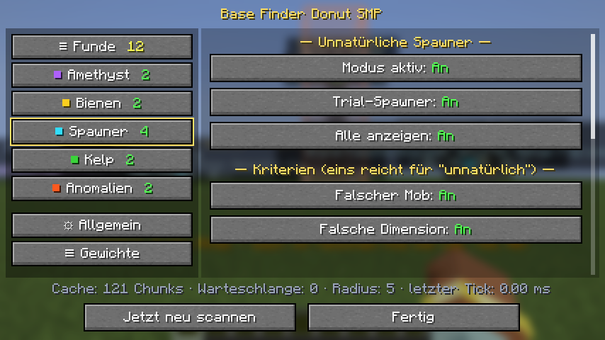

# Base Finder Donut SMP

[English](README.md) · **Deutsch**

Clientseitige Fabric-Mod für **Minecraft 1.21.11**. Sie scannt im Hintergrund die Chunks, die dein Client geladen hat, und markiert nur die besten Funde:

| Modus | Was markiert wird | Farbe |
|---|---|---|
| **Anomalien** | Chunks, die nicht wie frisch generiertes Gelände aussehen: künstliches Licht, Werkbänke, Truhen, Betten, Glas … | rot/orange |
| **Spawner** | Spawner, die so nicht natürlich entstehen (falscher Mob, falsche Dimension, keine passende Struktur, freier Himmel, kein Mob). Natürliche Spawner werden zusätzlich gelistet | türkis |
| **Bienennester** | Nester und Bienenstöcke, die dort nicht natürlich entstehen können | gelb |
| **Amethyst** | Chunks mit den meisten ausgewachsenen Amethystclustern | lila |
| **Kelp** | Die höchsten zusammenhängenden Kelp-Säulen | grün |

Menü und Markierungen sind auf **Deutsch oder Englisch**, je nach Spielsprache.

> **Hinweis:** Dies ist ein Fan-Projekt und hat nichts mit dem Team von Donut SMP zu tun. Auf vielen Servern sind Mods wie diese verboten. Lies vorher die Regeln des Servers; die Nutzung erfolgt auf eigene Verantwortung.


## Installation
1. [Fabric Loader](https://fabricmc.net/use/) für 1.21.11 und die [Fabric API](https://modrinth.com/mod/fabric-api) installieren
2. `base-finder-donut-smp-1.0.0.jar` in den `mods`-Ordner legen

Der Server braucht nichts. Die Mod liest nur die Chunks, die dein Client ohnehin geladen hat, und sendet nichts an den Server.

## Bedienung
| Taste | Funktion |
|---|---|
| **G** | Menü öffnen |
| **H** | Markierungen ein-/ausblenden (das Scannen läuft weiter) |
| **J** | Alle geladenen Chunks sofort neu scannen, danach Zusammenfassung in der Actionbar |
| **K** | Scannen pausieren/fortsetzen |

Die Tasten lassen sich unter *Optionen → Steuerung → Tastenbelegung* ändern.

### Menü
Links stehen alle Suchmodi mit Farbe und aktueller Fundanzahl, rechts die Einstellungen.

- **Funde:** alle aktuellen Funde in einer Liste, filterbar nach Modus, sortierbar nach Entfernung, mit Suchfeld. Pro Fund: **○** zeigt in der Welt nur diesen Fund, **XYZ** kopiert die Koordinaten (z. B. für `/tp`), **✕** blendet ihn aus.
- **Pro Modus:** an/aus, Schwellen, Anzahl der Markierungen und die einzelnen Kriterien
- **Allgemein:** Scan-Radius, Rechenzeit pro Tick, Hintergrund-Durchlauf, Meldungen, Farben
- **Gewichte:** Gewicht pro Blocksorte, eigene Blöcke (z. B. `minecraft:tnt`), Listen natürlicher Lichtquellen

Alles steht auch in `config/base_finder.json`. Einstellungen einer Vorversion (`config/cool_mod_69.json`) werden beim ersten Start übernommen.



## So funktioniert die Erkennung

**Anomalie-Score:** Pro Chunk werden Punkte addiert: künstliche Lichtquellen (Fackel 1, Laterne 1,5, Leuchtstein 2 … pro Stück), Licht unter der Oberfläche, das keine natürliche Quelle wie Lava oder Leuchtflechten erklärt, andere künstliche Blöcke mit niedrigen Gewichten und eigene Blöcke. Ab Score 12 wird ein Chunk gemeldet. „Wahrscheinlich Basis“ steht da, wenn mehrere Lichtquellen-Sorten und mehrere andere künstliche Blöcke zusammenkommen. Natürliche Strukturen (Dörfer, Mineshafts, Festungen, Trial Chambers, Ancient Cities, Nether-Festungen, Bastionen, End-Städte …) werden an typischen Blöcken erkannt und ausgeblendet, außer ihr Score liegt weit über dem üblichen Wert.

**Spawner:** Zombie, Skelett und Spinne gehören ins Verlies (Bruchstein), Höhlenspinnen in Mineshafts, Silberfischchen in Festungen, Lohen in Nether-Festungen und Magmawürfel in Bastionen. Trial-Spawner gehören in Trial Chambers. Passen Mob, Dimension oder Umgebung nicht, liegt der Spawner unter freiem Himmel oder ist leer, wird er als unnatürlich markiert. In Vanilla lassen sich Spawner nicht abbauen und umsetzen.

**Bienennester:** Natürlich ist ein Nest nur oberirdisch, in der Oberwelt, in einem passenden Biom (Ebene, Wald, Birkenwald, Wiese, Kirschhain, Mangrovensumpf …) und an einem Baum. Trifft eins davon nicht zu, wird es markiert. Die Bienenanzahl kennt der Client nur im Einzelspieler; auf Servern steht dort „?“.

**Leistung:** Gescannt wird beim Laden eines Chunks und nach relevanten Blockänderungen. Die Arbeit wird in kleine Schritte zerlegt, standardmäßig höchstens 2 ms pro Tick. In Tests waren das 30–50 Chunks pro Sekunde, ohne spürbaren FPS-Einbruch.

## Grenzen
- Nur geladene Chunks: Die Reichweite ist durch die Sichtweite des Servers begrenzt.
- Die Struktur-Erkennung ist eine Schätzung. Bauten aus typischen Struktur-Blöcken können ausgeblendet werden, ungewöhnliche Strukturteile können auftauchen.
- Ein Spawner, den ein Plugin in eine passende Umgebung gesetzt hat, sieht natürlich aus.
- Getestet mit echten Vanilla-Strukturen und einer normal generierten Welt. Lohen- und Magmawürfel-Spawner sowie Ozeanmonument und Waldanwesen konnten im Test nicht erzeugt werden.

## Bauen
Java 21 wird benötigt.
```
./gradlew build
```
Die Datei liegt danach in `build/libs/`. Mit `./gradlew runClientGameTest` laufen automatische Tests im echten Spiel.

## Lizenz
MIT, siehe [LICENSE](LICENSE). Autor: redstone_nugget.
