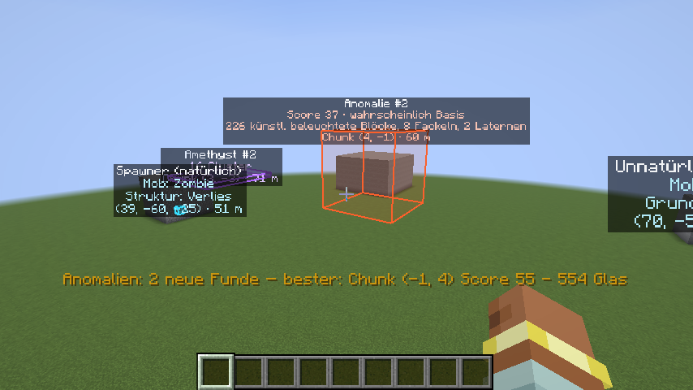
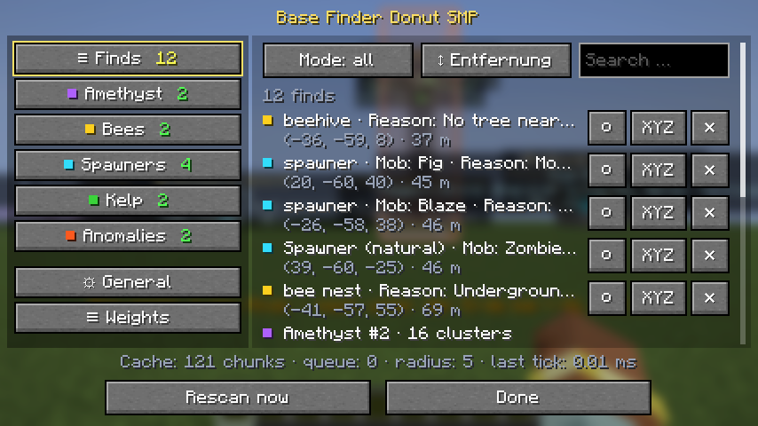

# Base Finder Donut SMP

**English** · [Deutsch](README.de.md)

Client-side Fabric mod for **Minecraft 1.21.11**. It scans the chunks your client has loaded in the background and marks only the best finds:

| Mode | What gets marked | Color |
|---|---|---|
| **Anomalies** | Chunks that don't look like freshly generated terrain: artificial light, crafting tables, chests, beds, glass … | red/orange |
| **Spawners** | Spawners that can't generate like that (wrong mob, wrong dimension, no matching structure, open sky, no mob). Natural spawners are listed as well | cyan |
| **Bee nests** | Nests and beehives that can't generate naturally there | yellow |
| **Amethyst** | Chunks with the most fully grown amethyst clusters | purple |
| **Kelp** | The tallest connected kelp columns | green |

Menu and markers are in **English or German**, depending on your game language.

> **Note:** This is a fan project and is not affiliated with the Donut SMP team. Many servers don't allow mods like this one. Check the server rules first; use at your own risk.



## Installation
1. Install the [Fabric Loader](https://fabricmc.net/use/) for 1.21.11 and the [Fabric API](https://modrinth.com/mod/fabric-api)
2. Put `base-finder-donut-smp-1.0.0.jar` into your `mods` folder

Nothing is needed on the server. The mod only reads chunks your client has loaded anyway and sends nothing to the server.

## Controls
| Key | Action |
|---|---|
| **G** | Open the menu |
| **H** | Show/hide markers (scanning keeps running) |
| **J** | Rescan all loaded chunks now, then show a summary in the action bar |
| **K** | Pause/resume scanning |

Keys can be changed under *Options → Controls → Key Binds*.

### Menu
The left side lists all search modes with their color and current number of finds, the right side shows the settings.

- **Finds:** all current finds in one list, filter by mode, sort by distance, search box. Per find: **○** shows only this find in the world, **XYZ** copies the coordinates (e.g. for `/tp`), **✕** hides it.
- **Per mode:** on/off, thresholds, number of markers and the individual criteria
- **General:** scan radius, time budget per tick, background pass, messages, colors
- **Weights:** weight per block type, custom blocks (e.g. `minecraft:tnt`), lists of natural light sources

Everything is also stored in `config/base_finder.json`. Settings from a previous version (`config/cool_mod_69.json`) are taken over on first start.



## How detection works

**Anomaly score:** points are added per chunk: artificial light sources (torch 1, lantern 1.5, glowstone 2 … each), light below the surface that no natural source such as lava or glow lichen explains, other artificial blocks with low weights, and custom blocks. From a score of 12 a chunk is reported. "Probably a base" appears when several kinds of light sources and several other artificial blocks come together. Natural structures (villages, mineshafts, strongholds, trial chambers, ancient cities, Nether fortresses, bastions, End cities …) are recognized by their typical blocks and hidden unless their score is far above the usual value.

**Spawners:** zombies, skeletons and spiders belong in dungeons (cobblestone), cave spiders in mineshafts, silverfish in strongholds, blazes in Nether fortresses and magma cubes in bastions. Trial spawners belong in trial chambers. If mob, dimension or surroundings don't fit, the spawner is under open sky or empty, it is marked as unnatural. In vanilla, spawners can't be picked up and moved.

**Bee nests:** a nest is natural only if it is above ground, in the Overworld, in a fitting biome (plains, forest, birch forest, meadow, cherry grove, mangrove swamp …) and on a tree. If one of these doesn't apply, it is marked. The client only knows the bee count in singleplayer; on servers it shows "?".

**Performance:** chunks are scanned when they load and after relevant block changes. The work is split into small steps, by default at most 2 ms per tick. In tests that was 30–50 chunks per second without a noticeable FPS drop.

## Limits
- Loaded chunks only: the range is limited by the server's view distance.
- Structure detection is an estimate. Builds made of typical structure blocks may be hidden, unusual structure parts may show up.
- A spawner that a plugin placed into fitting surroundings looks natural.
- Tested with real vanilla structures and a normally generated world. Blaze and magma cube spawners, ocean monuments and woodland mansions couldn't be generated in the tests.

## Building
Requires Java 21.
```
./gradlew build
```
The jar ends up in `build/libs/`. `./gradlew runClientGameTest` runs automated tests in the real game.

## License
MIT, see [LICENSE](LICENSE). Author: redstone_nugget.
